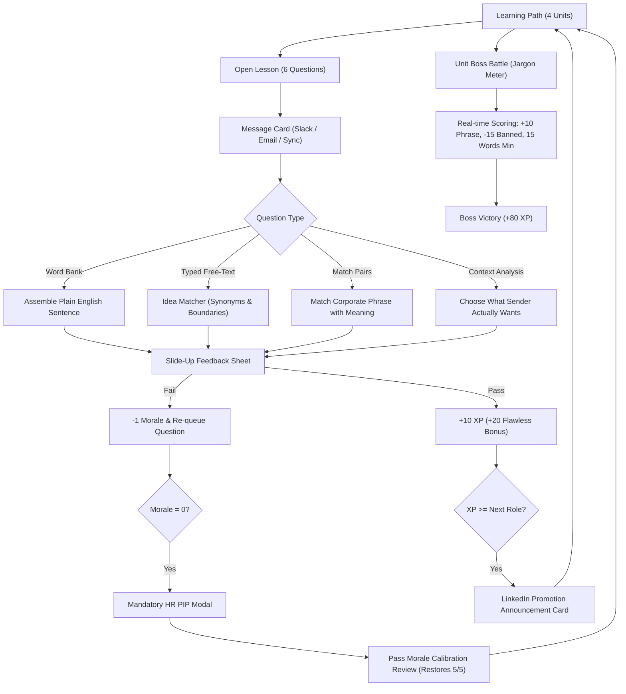

# 🪴 Circle Back: Learn Corporate Speak

> A Duolingo remix for decoding and speaking corporate jargon. Built for the **Steal//Remake Hackathon** (Neura AI Club).

[](./tests)
[](./LICENSE)
[](#architecture)

---

## 1. What is Circle Back?

**Circle Back** reimagines the gamified language-learning format of Duolingo to teach people how to survive, decode, and speak the dialect of modern enterprise: **Corporate Speak**.

Instead of translating English to Spanish, players translate lines of passive-aggressive office jargon, evasive meeting maneuvers, and LinkedIn humblebrags into plain, honest English. Each unit concludes with a reverse-direction **Boss Battle**, where players compose high-grade corporate evasions evaluated in real-time by a rule-based **Jargon Meter**.

---

## 2. Steal//Remake Hackathon Attribution

### Original Project
- **[Duolingo](https://www.duolingo.com)** (used as structural inspiration for the progression and interaction loop).

### What Changed
| Feature | Duolingo Original | Circle Back Remix |
|---|---|---|
| **Subject Matter** | Foreign languages (Spanish, French, etc.) | Corporate Speak (Meeting jargon, HR speak, LinkedIn) |
| **Answer Verification** | Exact string & token matching | **Idea Matcher**: checks meaning & synonyms on word boundaries |
| **Unit Climax** | Review checkpoints | **Reverse Boss Battles**: write corporate evasions scored by a **Jargon Meter** |
| **Failure State** | Hearts deplete & lock you out | **Performance Improvement Plan (PIP)**: mandatory HR calibration |
| **Streak** | Daily practice streak | **Days of Uninterrupted Productivity** |
| **Rank Ladder** | Generic Bronze/Diamond leagues | **Job-Title Ladder**: Intern → Chief Synergy Officer (CSO) |
| **Promotions** | Scoreboard placement | LinkedIn-style celebratory announcement cards (copyable satire) |
| **Mascot** | Duo the Owl | **Gerald the Office Ficus** (3 SVG states: Thriving, Neutral, Wilting) |
| **Sound Effects** | Prerecorded audio files | **Procedural Web Audio API** synth (100% offline, zero latency) |

### Related Work
Web tools like Kagi Translate have added a "LinkedIn Speak" filter, and browser extensions exist that highlight buzzwords. Circle Back is distinct: it is a structured, gamified educational course with progression, feedback sheets, and an interactive real-time constraint evaluator.

---

## 3. Core Architecture & Game Loop



### 3.1 Course Units

1. **Unit 1: Meeting Survival**
   - *Theme:* Postponing discussions forever, fake bio breaks, 30,000-foot slide decks, and parking lot graveyards.
   - *Boss:* **The Friday 4:30 PM Sync Evader** (Decline an executive sync without saying "no" or "can't").
2. **Unit 2: Email Passive-Aggression**
   - *Theme:* "Per my last email", CC'ing entire departments for mutual assured destruction, and presumptive compliance.
   - *Boss:* **The Lethal Paper Trail** (Remind a client they ignored an attachment without direct insults).
3. **Unit 3: Performance Review Speak**
   - *Theme:* "Opportunity for growth" (failure), "wearing multiple hats" (understaffed), and unearned executive presence.
   - *Boss:* **The Performance Review Reframe** (Reframe a missed quarterly roadmap as strategic agility).
4. **Unit 4: LinkedIn Announcements**
   - *Theme:* Humblebragging, Canva consultants, and ending posts with the algorithm trap: *"Agree?"*
   - *Boss:* **The LinkedIn Phoenix** (Reframe an abrupt layoff into an inspirational hero's journey).

---

## 4. Key Mechanics

### The Idea Matcher (Typed Translation)
Rather than forcing exact string matching, answers in Units 3 & 4 are evaluated by semantic idea groups:
- Lowercases and strips punctuation.
- Searches for synonym phrases on strict word boundaries (handling natural suffixes like plurals and tenses).
- Evaluates against the required `needed` threshold.
- Renders detailed feedback on which ideas were recognized and which were missed.

### The Jargon Meter (Boss Battles)
Reverse direction challenge: players write corporate replies under workplace pressure:
- `+10 points` per distinct corporate buzzword detected (capped at 60 base).
- `-15 points` per banned plain word hit.
- Minimum length of 15 words (otherwise score is capped at 40).
- Pass condition: `Score >= 60`, minimum phrases satisfied, and zero banned words.

### The Game Layer
- **Morale (Hearts):** 5 maximum. Deducts 1 per error. At 0, keycard access is revoked and the player enters the **Performance Improvement Plan (PIP)** modal. Passing the remedial review restores full morale.
- **Mascot Gerald (Office Ficus):** Three custom SVG states:
  - 🌿 **Thriving:** Sunglasses, corporate tie, vibrant leaves (*"High leverage detected!"*).
  - 🪴 **Neutral:** Wireframe glasses, calm (*"Let's touch base on your deliverable."*).
  - 🍂 **Wilting:** Drooping yellowed leaves, panic sweat (*"HR is monitoring our optics..."*).
- **Synergy League:** Fictional leaderboard ranking you against coworkers like *Chad from Sales* and *Brenda from Escalations*.
- **Persistence:** LocalStorage key `circleback:v1`. Zero backend or third-party tracking required.

---

## 5. Development & Testing

### Prerequisites
- Node.js (v18+) & npm

### Quick Start
```bash
# Clone the repository
git clone https://github.com/your-username/circle-back.git
cd circle-back

# Install dependencies
npm install

# Run Vite development server
npm run dev
```

### Run Automated Tests
```bash
# Run Vitest unit tests for the Idea Matcher and Jargon Meter
npm test
```

### Exercise Generation Script
```bash
# Regenerates src/data/units.json from src/data/phrases.csv and bosses.json
npm run generate
```

### Production Build
```bash
npm run build
npm run preview
```

---

## 6. Two-Minute Demo Script (For Judges)

1. **Boss Battle & Jargon Meter:**
   - Click **"⚡ Test Unit 1 Boss"** in the footer.
   - Type a casual plain response: *"No I can't attend, I am busy this weekend."* Notice the Jargon Meter triggers banned-word penalties and caps score at 40.
   - Now type: *"Due to a hard stop and limited bandwidth, let us take this offline, touch base later, and circle back to review our action items."*
   - Watch the Jargon Meter score jump to 60+, firing green pills and the victory confetti!
2. **Translate & Feedback Sheet:**
   - Return to **Unit 1, Lesson 1**.
   - Answer a question incorrectly to demonstrate the **-1 Morale loss** and question re-queuing.
   - Complete the question to see the model translation and the satirical *"Why people talk this way"* insight card.
3. **Performance Improvement Plan (PIP):**
   - When Morale drops to 0, the official HR Compliance PIP modal appears. Click **"Begin Mandatory Calibration"** to restore morale.
4. **Career Ladder & LinkedIn Promotion:**
   - Click the rank badge in the top bar to inspect the 7-tier corporate ladder from **Intern** to **Chief Synergy Officer**.
   - Review the copyable satire post ready for LinkedIn!

---

## 7. License

Released under the [MIT License](./LICENSE). Full asset and font attributions are available in [CREDITS.md](./CREDITS.md).
